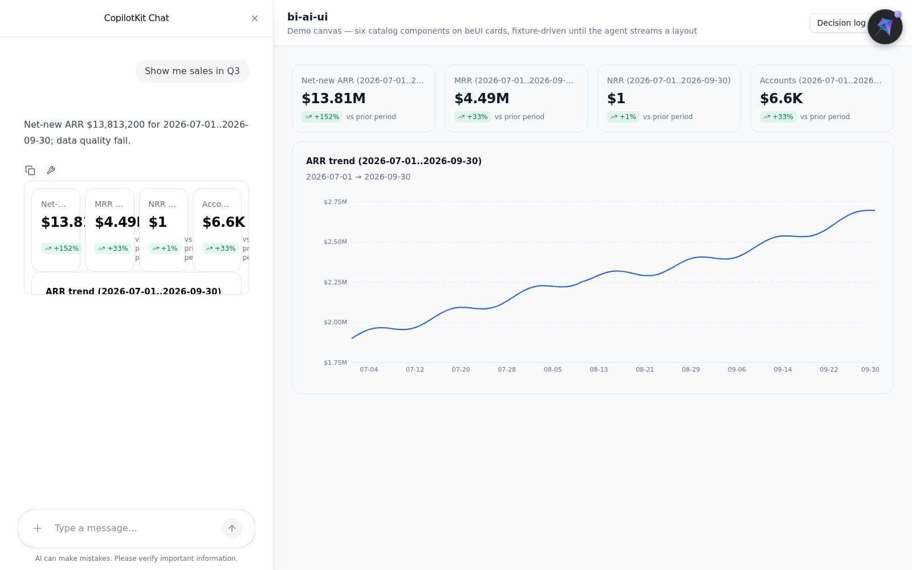
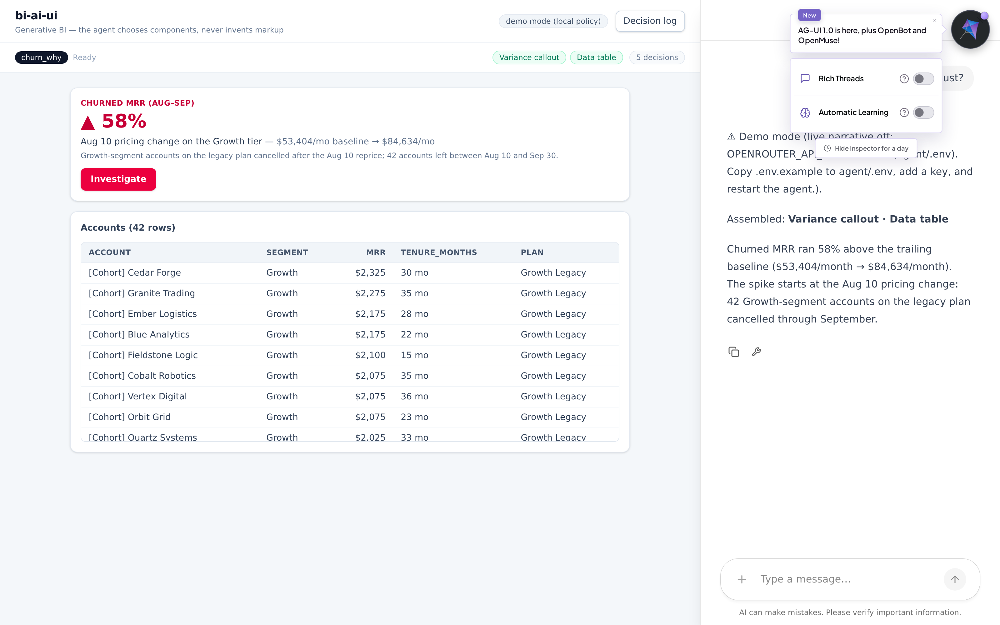
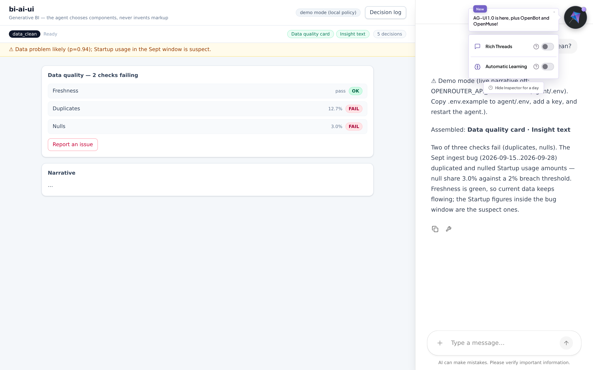
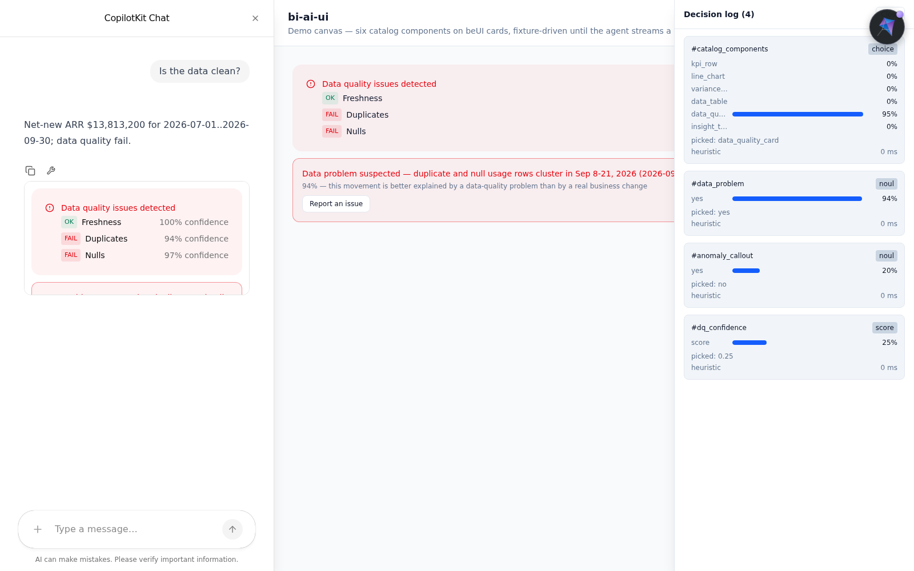

# bi-ai-ui

AI business-intelligence dashboard where a chat agent answers natural-language
queries by composing the UI from a fixed catalog of pre-built, design-system
components — the agent classifies each query, assembles a validated layout,
and streams the narrative from an OpenRouter text model; it never invents
markup. Full product spec: [.agents/PRDs/PRD.md](.agents/PRDs/PRD.md).

## Architecture

```
React SPA (Vite) :5173           FastAPI agent (LangGraph) :8123     OpenRouter
┌─────────────────────────┐  AG-UI SSE  ┌───────────────────────┐  OpenAI-compatible
│ CopilotKit v2 provider  │ ──────────▶ │ POST /copilotkit      │ ─────────────▶
│ HttpAgent · CopilotSidebar│◀──────────│ five-node agent graph │   text model (fill)
└─────────────────────────┘ token deltas │ read_state → decide   │ ◀─── decisions ──┐
         ▲ shared state                  │ → layout → query → fill│                 │
         └── a2ui · decisions · status   └───────────┬───────────┘   decisions-modality │
                                                     ▼                (key: agent/.env)
                                      ┌───────────────────────────┐
                                      │ SQLite — data/app.db      │
                                      │ deterministic seeded mock │
                                      │ accounts + daily events   │
                                      └───────────────────────────┘
```

- The browser connects directly to the FastAPI agent (no Node runtime in
  between, PRD v1.1); the agent's CORS allows only the Vite dev origin
  (`agent/server.py`).
- The agent is a five-node LangGraph graph (`agent/graph.py`):
  `read_state` loads window-scoped KPI aggregates + data-quality stats from
  SQLite, `decide` fans a ≤7-question catalog set out through the
  probabilistic `DecisionClient` (OpenRouter's alpha decisions endpoint with
  a chat fallback chain, `agent/decision/`; a deterministic heuristic transport
  when no key is configured; off-catalog queries (no data domain) are
  answered by the deterministic guard transport without consulting the
  wired model (issue #18)), `layout` builds the A2UI draft from
  above-threshold picks and parse-asserts it through the Pydantic catalog
  (`agent/catalog.py`), `query` runs slot-scoped SQL for the surviving
  components, and `fill` makes exactly one streamed text-model call writing
  the narrative into `slotCopy`. Shared state — `a2ui`, `decisions[]`,
  `status` — is streamed to the client on every node transition; the final
  text reply is the fill summary. The sidebar's chat answers are composed
  onto the fullscreen canvas: the SPA renders the streamed `a2ui` directly
  (`web/src/hooks/useA2UI.ts`, latest run wins), with the demo fixture as
  the pre-run fallback.
- Mock B2B-SaaS data lives in `data/app.db` (gitignored), generated
  deterministically by `python agent/scripts/generate_data.py`: ~5–8k
  accounts plus 24 months (2024-10-01 → 2026-09-30) of daily
  `subscription_events` / `revenue_events` / `usage_events` with three
  planted shapes — a Q3-2026 net-new-ARR growth ramp, an Aug-10-2026
  pricing-change churn spike (~40 Growth-segment accounts adopt a new plan
  and cancel through 2026-09-30), and a Sept 8–21 ingest bug (exact
  duplicates plus NULL-amount usage rows, Startup segment only); the schema
  is documented in the script's docstring and opened via `agent/db.py`.
  `agent/quality.py` runs the freshness / duplicates / nulls data-quality
  checks over an inclusive date scope (default: the trailing 30 days ending
  at the latest observed event day), returning `{name, status, score}` rows
  for the "Is the data clean?" card. Since issue #17 the card reads where
  the data is actually dirty: `recent_problem_scope()` scans the trailing
  120 days for duplicate/null-corrupted usage rows and reports the
  contiguous anomalous window with its majority segment (on the seeded DB:
  Sept 8–21, 2026, Startup) — `read_state` scopes the decision-context
  checks to it (`snapshot["dq_scope"]`), and the canvas card stamps the
  `data_problem` Noul probability plus the narrated window/segment detail
  so the frontend shows a warning banner with a "Report an issue"
  affordance (console log + toast; no backend) above a deterministic
  `data_quality_card.summary` slot.
- Both services run from `docker-compose.yml` (web dev server :5173,
  agent :8123).

## Quickstart

Requires only Docker — no API key is needed to boot (chat needs one).

```bash
git clone https://github.com/techafreshh/bi-ai-ui.git && cd bi-ai-ui
cp agent/.env.example agent/.env
docker compose up
```

- SPA: http://localhost:5173 — open it and chat in the sidebar ("ping").
- Agent: http://localhost:8123 — `GET /health` returns exactly `{"status": "ok"}`.
- Boot is DB-less (issue #70): no dataset is generated at boot — the
  canvas shows `No dataset loaded — upload CSV or load sample` until data
  exists. Generate one manually with `./scripts/reset_data.sh` (below).

### Step 1 — load data first (upload-first)

The canvas stays empty until a dataset exists. Pick one path — no rebuild,
no restart:

- Empty-state card: drop a CSV onto the upload dropzone (table is inferred
  from the filename stem) or press **Load sample** — the dropzone uploads
  via `POST /data/upload`, the sample button fires `POST /data/sample`.
- Header DatasetPicker: the same upload / load-sample actions, plus the
  active-dataset switch (`POST /data/active`).
- Or from a shell: `curl -X POST http://localhost:8123/data/sample`
  (assembles the `samples/` miniature and activates it in one call).

Reset the database from scratch (deterministic — reruns yield identical
row counts) without host Python, then restart the stack:

```bash
docker compose down -v
./scripts/reset_data.sh
docker compose up -d
```
- Without an OpenRouter key in `agent/.env`, both services still boot and
  `/health` keeps returning 200; the graph still runs end-to-end — the
  decider falls back to its deterministic heuristic transport and fill
  writes KPI-grounded copy instead of model text.

### Metrics: metrics.yaml plus the two read legs

Queryable metrics are compiled from `agent/semantics/metrics.yaml`
(`net_new_arr`, `mrr`, `nrr`, `churn_rate`, `active_accounts`,
`data_quality`, `gross_churned_arr`, `active_accounts_eom`). Two read-only
HTTP legs serve them with no decider: the picker leg
`GET /data/run?metric=&start=&end=&segment=` composes a validated layout,
and the SQL leg `POST /data/query` runs one leading-SELECT statement with
a row cap — `scripts/verify_data_slice.py` proves both legs agree with the
NL answer within 1% and prints `parity: ok`.

### Postgres second source

`DATASOURCE_URL=postgresql://…` selects the read-only Postgres source
(`agent/data/postgres_source.py`, same templates as the SQLite path): load
the samples once with `DATASOURCE_URL=… scripts/load_postgres.sh`, restart
the agent with the same `DATASOURCE_URL`, then prove parity with
`python3 scripts/verify_data_slice.py --target postgres`.

### Sample datasets: unplanted random data

The seeded profile's three shapes are choreographed for the demo (PRD
§7). To test the agent against data it was **never staged for** — organic
growth, a churn spike in an unpredictable month/segment, an ingest bug in
an unpredictable window — generate the random profile:

```bash
./scripts/reset_data.sh --restart --profile random --seed 7
```

`--seed` picks the shapes (the same seed always rebuilds the identical
dataset; different seeds draw different ones) and `--restart` stops and
restarts the agent around the regeneration. On host Python instead:
`python agent/scripts/generate_data.py --profile random --seed 7`.
The summary the generator prints names the drawn spike/bug windows so you
know what to ask — e.g. ask "Why did churn spike in {the drawn month}?"
instead of the demo script's "August". Two things differ on this profile:

- The demo script's exact numbers (Q3 ramp, 40-row cohort, Sept bug) are
  the *seeded* profile's; on random data the same queries still stream the
  same component pairs, composed from whatever the data holds.
- `scripts/verify_demo.py` pins the seeded shapes (38–50 cohort rows,
  duplicates:fail …) — its planted-shape probes are expected to MISS on a
  random-profile DB; switch back with a bare `./scripts/reset_data.sh`.

### Full-data reproducer

Full data is reproducible without committing blobs: `agent/scripts/generate_data.py`
(the flags mirror the module docstring verbatim — money is INTEGER cents, dates
are TEXT `YYYY-MM-DD`) builds a full-scale DB (~2.9M rows) at any `--db-path`:

```bash
python agent/scripts/generate_data.py --db-path ./data/sandboxes/<id>.db --profile seeded
python agent/scripts/generate_data.py --db-path ./data/sandboxes/<id>.db --profile random --seed 7
```

- `--profile seeded` (default) plants the three choreographed demo invariants —
  the Q3-2026 net-new-ARR growth ramp, the Aug-10-2026 pricing-change churn
  spike (40 Growth-segment repriced-then-cancelled accounts), and the Sept 8–21
  Startup-only ingest bug (exact duplicates plus NULL units). `--seed` is
  accepted but ignored here, so the output stays byte-identical to the demo
  contract.
- `--profile random` plants none of the choreographed shapes: organic growth,
  a seed-picked churn spike (month/segment/count) and a seed-picked 14-day
  ingest bug. `--seed N` picks the shapes — the same seed always rebuilds the
  identical dataset, different seeds draw different ones; the printed summary
  names the drawn spike/bug windows.
- The script creates missing parent dirs (`data/sandboxes/` included) and
  unlinks an existing target first, so reruns over the same path are idempotent
  instead of appending duplicate rows. `data/` stays gitignored — sandbox DBs
  are never committed.
- Sandbox handoff: the file the generator wrote becomes the active dataset via
  `DB_PATH=./data/sandboxes/<id>.db` (resolved by `agent/db.py`, empty/unset
  falls back to `data/app.db`).
- Release-asset flow: full-scale CSVs/SQLite ship as release assets only, never
  as committed blobs — the repo stays lean, `samples/` plus this generator
  reproduce everything (see the `samples/README.md` parity note).

## Environment

```bash
cp agent/.env.example agent/.env   # server-side only; agent/.env is gitignored
```

Set your OpenRouter key (create one at https://openrouter.ai/keys) in
`agent/.env` and restart the agent. The key never reaches the browser.

| Variable | Required | Purpose |
|---|---|---|
| `OPENROUTER_API_KEY` | yes (for chat) | OpenRouter key for the text model; without it the agent still boots, the decider falls back to its heuristic transport and fill writes KPI-grounded copy |
| `TEXT_MODEL` | no (default `openai/gpt-6-luna`) | Chat model the fill node streams the narrative from |
| `OPENROUTER_BASE_URL` | no (default `https://openrouter.ai/api/v1`) | OpenAI-compatible base for the text model and the chat decision fallback; a non-default value also makes the decisions transport use `{base}/decisions` |
| `DECISION_ENDPOINT` | no (default `https://openrouter.ai/api/alpha/decisions`) | Full decisions-modality URL; overrides the `OPENROUTER_BASE_URL`-derived decisions path |
| `DECISION_MODEL` | no (default `~perplexity/pplx-decider-flash-latest`) | Decisions-modality model the primary decision transport POSTs to; shown verbatim as `decisions[].model` |
| `DECISION_MODEL_CHOICE` | no (default empty) | Per-type `DECISION_MODEL` override for choice questions only; empty or whitespace = use `DECISION_MODEL` |
| `DECISION_MODEL_NOUL` | no (default empty) | Per-type `DECISION_MODEL` override for noul questions only; empty or whitespace = use `DECISION_MODEL` |
| `DECISION_MODEL_SCORE` | no (default empty) | Per-type `DECISION_MODEL` override for score questions only; empty or whitespace = use `DECISION_MODEL` |
| `DECISION_FALLBACK_MODELS` | no (default `openai/gpt-6-luna,anthropic/claude-haiku-5.5`) | Comma-separated chat-completions fallback chain (json_schema structured output); members must be chat models |
| `DECISION_THRESHOLD` | no (default `0.6`) | Min probability for `above_threshold` flagging on decision answers; below it the component is cut from the layout |
| `DECISION_TIMEOUT_S` | no (default `8.0`) | Per-request timeout in seconds for both decision transports |
| `SPA_ORIGIN` | no (default `http://localhost:5173,tauri://localhost`) | Comma-separated browser-origin allowlist for the agent's CORS middleware; the Tauri shell origin rides alongside the Vite dev origin — set it when the SPA is served from a different origin (e.g. a remapped Docker web port) |
| `AGENT_HOST` | no (default `0.0.0.0`) | Bind host for `python server.py` (the `--host` default), read ahead of `HOST` |
| `HOST` | no (default `0.0.0.0`) | Fallback bind host when `AGENT_HOST` is unset or empty |
| `AGENT_PORT` | no (default `8123`) | Bind port for `python server.py` (the `--port` default), read ahead of `PORT` |
| `PORT` | no (default `8123`) | Fallback bind port when `AGENT_PORT` is unset or empty |
| `DB_PATH` | no (default empty) | Path of the active per-dataset sandbox SQLite file (`data/sandboxes/<id>.db`, written by `agent/sandbox.py`); empty or unset means no active DB and `agent/db.py` falls back to `data/app.db` |
| `DATASOURCE_URL` | no (default empty) | Alternate datasource URL; empty means local SQLite path resolution as today, a `postgresql://` value selects the read-only Postgres source (`scripts/load_postgres.sh` loads the samples; `agent/data/postgres_source.py`) |
| `DATASOURCE_RO` | no (default `1`) | Read-only guard: only `1`/`true`/`yes` boot; anything else refuses to start with a read-only error on stderr before binding |
| `UPLOAD_MAX_MB` | no (default `25`) | Decimal megabytes capping `POST /data/upload` CSV bodies; larger files are rejected with 400 before any write; non-numeric or empty values fall back to the default |
| `SQL_ROW_LIMIT` | no (default `50`) | Default row cap for the churn cohort/driver queries; non-numeric, empty or out-of-range values fall back to the default |
| `SQL_TIMEOUT_S` | no (default `5.0`) | sqlite connect timeout in seconds; non-numeric, empty or non-positive values fall back to the default |
| `SAMPLES_DIR` | no (default empty) | Directory `POST /data/sample` reads its four CSVs from (docker-compose mounts repo-root `samples/` at `/samples`); empty or unset means the repo-root `samples/` dir anchored from `agent/server.py` |

Every variable above exists in [`agent/.env.example`](agent/.env.example)
with its default as the value, so copying the file is behavior-neutral.
Changes apply when the agent (re)starts: `docker compose up -d agent`
picks up an edited `agent/.env` by recreating the container — no rebuild,
no code edits. Per-type overrides left empty fall back to `DECISION_MODEL`,
and each decision's `model` field names the model that actually answered
it (the heuristic fallback reports `"heuristic"`, never a guessed string).

### Remapped Docker ports

The host-side ports and the browser-visible agent URL are env-driven, so the
stack can run away from 5173/8123. Put these in a repo-root `.env`
(gitignored; Compose reads it for interpolation), then rebuild:

```bash
AGENT_HOST_PORT=10329
WEB_HOST_PORT=12308
VITE_AGENT_URL=http://localhost:10329/copilotkit
SPA_ORIGIN=http://localhost:12308
```

```bash
docker compose up -d --build
```

`VITE_AGENT_URL` is the URL the BROWSER calls (not the in-container
`http://agent:8123`); `SPA_ORIGIN` must be the SPA's browser origin or the
agent's CORS preflight rejects the chat. `scripts/verify_demo.py` defaults
to the 8123/5173 pair — override `AGENT_URL` and `WEB_URL` to match.

Desktop note: the Tauri shell rides `SPA_ORIGIN` alongside the Vite dev
origin, so the desktop build passes preflight with no code change.

## Demo script

A 90-second tour of the three golden paths. Setup once (`cp agent/.env.example
agent/.env`, `docker compose up`), then open http://localhost:5173 and
type each query into the sidebar prompt (`Type a message…`). No API key is
needed — without one the decider runs its deterministic heuristic transport
and the narrative is KPI-grounded copy.

| Time | You type | The canvas assembles |
|---|---|---|
| 0:00 | `Show me sales in Q3` | Four KPI tiles (net-new ARR, MRR, NRR, accounts, each labelled with the `2026-07-01..2026-09-30` window) plus an ARR trend line chart over Jul–Sep 2026; the chat answers with a mini-card and a one-line summary. |
| 0:25 | `Why did churn spike in August?` | A variance callout (`churn rate moved +100%` vs the trailing 6-month average, cause: the Aug-10 pricing change) above a 40-row cohort table (segment, MRR, tenure_months, plan). Press **Investigate** on the callout to drill into the Growth cohort on the same thread. |
| 0:50 | `Is the data clean?` | A data-quality card (Freshness ok, Duplicates fail, Nulls fail) under a warning banner naming the Sep 8–21 Startup ingest bug, with a **Report an issue** button. Open the **Decision log** in the header to see all four decisions with probabilities, model and latency. |
| 1:15 | `draw me a dragon` (optional) | An off-catalog query renders only the insight-text fallback — the control layer never invents components. |









## Model swap guide

Zero-code swap — edit `agent/.env` only, then recreate the agent (no image
rebuild):

```bash
# in agent/.env — the relevant lines:
# swap the decision model (visible in the drawer's decisions[].model):
DECISION_MODEL=inception/mercury-decide
# or override one question type only (choice / noul / score):
DECISION_MODEL_CHOICE=inception/mercury-decide
# swap the narrative (text) model:
TEXT_MODEL=openai/gpt-6-luna
# retire components below a stricter endorsement line:
DECISION_THRESHOLD=0.95
```

```bash
docker compose up -d agent   # recreate with the edited .env
```

Then ask a question: the Decision drawer shows the active model strings
per decision, and `docker compose exec agent printenv DECISION_MODEL`
confirms the compose-provided value without rebuilding the image.

## Verification

The PRD §11 checklist is executable — no manual clicking required:

```bash
docker compose up -d            # boot agent :8123 + web :5173 (empty by default — no dataset is generated at boot)
python3 scripts/verify_demo.py  # 15 stdlib-only HTTP/state probes, exit 0 on green (needs a loaded DB: ./scripts/reset_data.sh first)
python3 scripts/verify_data_slice.py --target sqlite  # release slice gate (issue #91): upload → triple-query parity → off-catalog safety, prints `parity: ok`
```

The probe suite waits for the stack, runs the Q3 query once, then checks the Q3 path (`kpi_row` + `line_chart`
over `2026-07-01..2026-09-30` + non-empty reply), the churn path
(`variance_callout` with pricing cause + 38–50-row cohort table), the DQ
path (`duplicates:fail, nulls:fail, freshness:ok` + `data_problem` p>0.7),
≥4 decisions with `model` + `latency_ms` on every golden query, the
off-catalog fallback (only `insight_text`, all decisions sub-threshold),
and a clean `RUN_FINISHED` on every run — printing one `[ok]`/`[FAIL]`
line per check plus a summary count.

```bash
cd web && npm run lint && npm run typecheck && npm run test
cd agent && uv run ruff check . && uv run pytest
npm run screenshots --prefix web   # recapture docs/*.png from the live app
```
